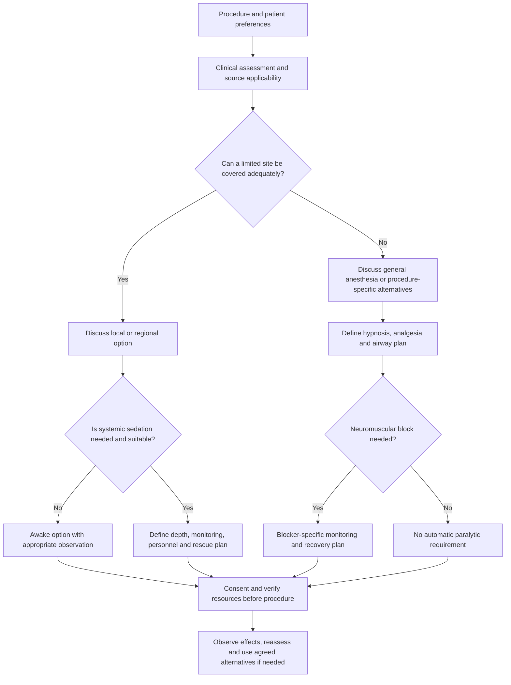
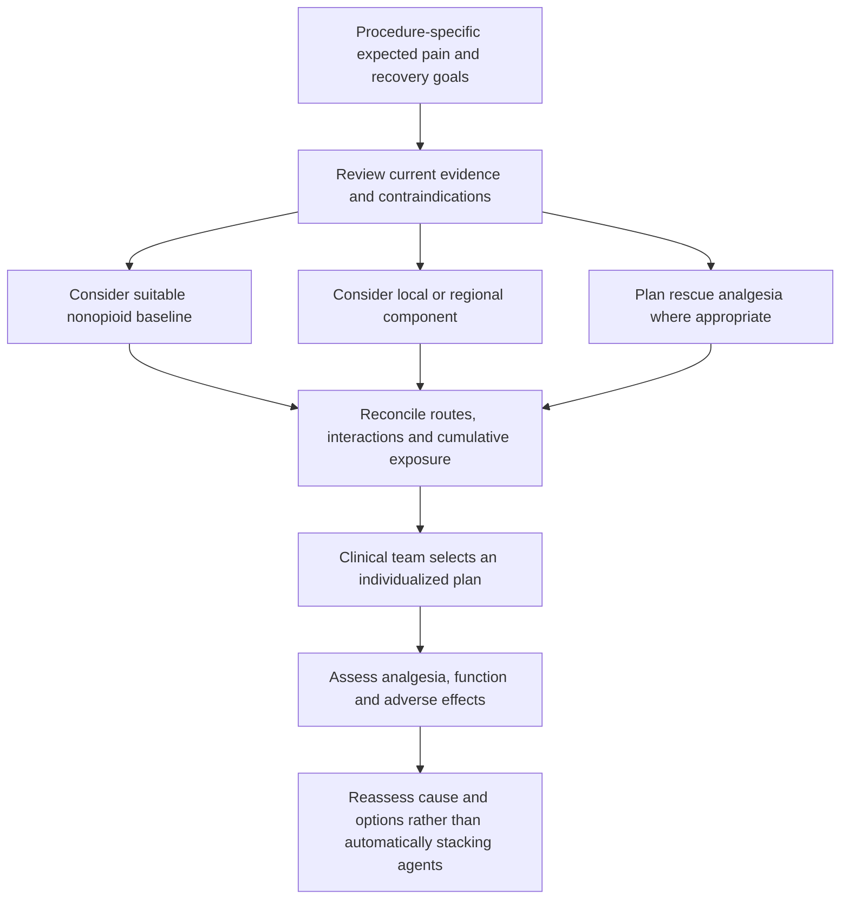

# Anesthesia options, standards and synthetic case discussions
28 October 2026 | Educational companion to [Smart NOA examples](GUIDELINE_INFORMED_EXAMPLES.md)

This guide compares general, regional, procedural sedation/MAC, and local anesthesia. Twelve entirely synthetic adult cases illustrate choices rather than prescriptions. They contain no shadowing encounters or patient records. All named drugs are options within particular contexts, not ingredients to combine automatically. Anesthesia selection and administration require a qualified clinical team, informed consent, appropriate facilities and an individualized assessment.

**Smart NOA does not implement these choices.** It has no propofol, volatile-agent, opioid, neuromuscular-block, regional-block, ventilation or sedation-depth controller. See the separate software walkthrough for its actual behavior. This guide adds educational context; it makes no new software or clinical-performance claim.

## 1. Distinguish the goals
- **Hypnosis/amnesia:** loss of awareness or memory. Propofol, for example, does not supply the whole analgesic plan.
- **Analgesia/antinociception:** addressing pain or responses to tissue injury; opioids, local/regional techniques and selected nonopioid agents have different roles.
- **Immobility:** may result from adequate anesthesia or require a neuromuscular blocker. Paralysis alone supplies neither unconsciousness nor analgesia.
- **Anxiolysis:** reducing anxiety; this does not necessarily require unconsciousness.
- **Recovery:** restoring appropriate consciousness, ventilation and neuromuscular function while managing pain and adverse effects.

These are distinct endpoints [G, T, N]. "Multimodal" means combining complementary approaches where justified; it does not mean more drugs are always better. Opioid-sparing may include opioids. If fentanyl, remifentanil or hydromorphone is given during the phase being described, that phase is not opioid-free. Avoiding opioids does not itself prove a safer anesthetic [P].

## 2. Four options, with combinations and limits
| Option | What it provides / possible use | Medication and route examples | Choice and monitoring limits |
|---|---|---|---|
| General anesthesia | Unconsciousness for procedures needing it, often including major abdominal operations | IV induction with a selected hypnotic such as propofol; etomidate or ketamine may be alternatives after assessment. Maintenance can use inhaled sevoflurane/isoflurane/desflurane **or** an IV technique such as propofol-based TIVA. Analgesia may include a selected IV opioid and/or local, regional and nonopioid components. | Not every case requires a paralytic or every listed component. Airway/ventilation support, delivery verification, physiological monitoring and recovery planning are integral [G, T, M]. |
| Regional anesthesia | Spinal/epidural or a peripheral block for a defined territory; may be sole surgical anesthesia or an adjunct to general anesthesia | Appropriate formulations of local anesthetics such as bupivacaine, ropivacaine or lidocaine, with route-specific selection. Selected neuraxial opioid adjuncts can be appropriate; peripheral adjuncts require a separate evidence and route assessment. | Not all agents/formulations are interchangeable across spinal, epidural and peripheral routes. Assess anticoagulants, infection, neurologic history, consent, block coverage and cumulative local-anesthetic exposure. Plan for inadequate block or conversion [A, R, O, L]. |
| Procedural sedation / monitored anesthesia care | Sedation spans minimal, moderate and deep states. MAC is an anesthesia service, not a depth or a synonym for "twilight sleep" | IV sedative options include propofol, midazolam or dexmedetomidine; a selected analgesic may be needed when the procedure is painful. Local anesthesia may reduce the need for systemic medication. | A three-drug combination is not mandatory. Sedatives and opioids can compound respiratory effects. The intended depth, personnel, monitoring and rescue capability must match the procedure and patient [S, M; ASA statements below]. |
| Local anesthesia | Topical or infiltrative anesthesia of a limited site, often suitable for minor skin procedures | Lidocaine is a common infiltration option; longer-acting agents or dental-specific products require procedure-specific selection. Epinephrine may prolong local effect and improve hemostasis where appropriate. | Local anesthesia does not itself produce unconsciousness. Drug, concentration, tissue site, total exposure and cardiovascular/perfusion considerations matter. A low total dose does not eliminate systemic-toxicity risk [L, X]. |

### Reversal is not "neostigmine with sugammadex"
For rocuronium or vecuronium, the 2023 ASA guideline favors sugammadex over neostigmine at deep, moderate and shallow block; neostigmine is a reasonable alternative at minimal block. Neostigmine is ordinarily paired with an **antimuscarinic**, such as glycopyrrolate, rather than routinely combined with sugammadex ([current neostigmine prescribing information](https://dailymed.nlm.nih.gov/dailymed/drugInfo.cfm?setid=088f96eb-20b8-48f8-ac83-329f75a44ce1)). Sugammadex is not a universal antagonist for cisatracurium or succinylcholine. Reversal selection follows drug identity and quantitative monitoring, not simply elapsed time. Confirming train-of-four ratio at least 0.9 before extubation addresses neuromuscular recovery; it is not the only extubation criterion [N].

### Regional adjuncts need route-specific language
Neuraxial fentanyl/morphine should not be treated as interchangeable with peripheral-nerve mixtures; neuraxial opioids bring respiratory-monitoring requirements [O]. Perineural dexmedetomidine and dexamethasone are off-label adjunct approaches rather than universally approved block ingredients; efficacy, neural safety, systemic effects and alternatives require appraisal [R]. IV sedation during a block is optional and changes the assessment/monitoring requirements. "Prefers to sleep" does not remove airway risk.

## 3. Standards and guideline checkpoints
These sources have different scopes; listing them does not establish compliance or accreditation.

| Checkpoint | What the educational plan should explain | Source / applicability |
|---|---|---|
| Preanesthesia discussion | Procedure, alternatives, preferences, previous anesthetic issues, medications, allergies, fasting/aspiration context, airway and relevant disease | WHO–WFSA international standards [W]; not a drug-selection formula |
| Monitoring | Qualified presence and assessment of oxygenation, ventilation, circulation and temperature. The current ASA text calls for clinical ventilation observation during moderate/deep sedation and every effort toward continual exhaled-CO2 monitoring. | ASA official standard; WHO–WFSA [W] and UK/Ireland guidance [M] offer complementary published context |
| IV general anesthesia | Verify infusion delivery and vascular access; discuss awareness prevention. Processed EEG is recommended by the cited TIVA guideline when neuromuscular block accompanies TIVA. | [T]; this does not validate Smart NOA or a target concentration |
| Neuromuscular blockade | Quantitative recovery assessment and blocker-specific antagonism | [N]; paralysis is not a sedation monitor |
| Regional technique | Procedure coverage, bleeding/antithrombotic assessment and route/formulation checks | Fifth-edition ASRA guideline [A]; timings depend on the actual drug, dose, organ function and procedure |
| Local-anesthetic exposure | Reconcile all local-anesthetic sources, monitor for toxicity and have trained response capability | [L, X]; the published LAST aid is linked, not copied or replaced here |
| Recovery / discharge | Pain, respiratory status, consciousness, mobility where relevant, handoff and appropriate discharge arrangements | [W, M, S]; a normal single reading is insufficient |

## 4. Shared case assumptions
All cases are fictional adults for teaching. Male/female labels are descriptive, not dosing rules; female examples below are nonpregnant. Height and weight are provided to expose assumptions, not establish a dose. "No stated disease" is not a clinical clearance. A real assessment could change every option.

Each pair keeps the procedure comparable. Changes in history explain differences in discussion; sex alone does not select the technique. We do not provide bolus sequences, block-injection instructions or pump settings for these incomplete profiles. Numerical source context and arithmetic for the three configured Smart NOA agents remain in the [existing supplement](GUIDELINE_INFORMED_EXAMPLES.md).

## 5. Six case pairs (12 cases)
### Pair 1 — Open abdominal surgery: general anesthesia with analgesic options
**GA-M:** male, 52 years, 178 cm, 82 kg; elective open colorectal surgery; no stated organ dysfunction, no listed allergies, no anticoagulant listed. He wants to understand postoperative pain control.

**GA-F:** female, 52 years, 165 cm, 68 kg; same procedure; chronic kidney disease and a prior NSAID-associated gastrointestinal bleed. She wants adequate analgesia without repeating that experience.

**Options discussed:** IV induction and inhaled maintenance, or an IV maintenance technique; selected opioid analgesia as clinically required; a procedure-appropriate fascial-plane block as a regional analgesic adjunct. The 2026 ASA guideline supports fascial-plane blocks for open abdominal surgery to reduce early postoperative pain and/or opioid requirements [B]. This adjunct does not replace general anesthesia for the operation.

**How the pair differs:** GA-F's history prompts review of NSAID suitability and other analgesic options; it does not justify automatic substitution with a dexmedetomidine/ketamine/lidocaine mixture. Acetaminophen suitability also needs review of hepatic history and all combination products. Both need an airway/ventilation plan, monitoring, and a postoperative reassessment plan. A selected IV opioid is an option, not an educational failure to remain opioid-free.

**Reassessment example:** inadequate analgesia after a block requires evaluation of cause and coverage; it is not automatically an indication to add more local anesthetic. Review cumulative exposure and the overall plan [X].

### Pair 2 — Laparoscopic abdominal surgery: IV versus inhaled maintenance
**IV-M:** male, 45 years, 181 cm, 86 kg; elective laparoscopic surgery; no stated organ dysfunction; asks whether general anesthesia can be maintained without an inhaled agent.

**IV-F:** female, 45 years, 164 cm, 63 kg; same procedure and question; difficult peripheral IV access is noted in the fictional history.

**Options discussed:** propofol-based TIVA is one maintenance approach; inhaled maintenance is another. A selected IV opioid or other analgesic component is considered separately. If a neuromuscular blocker is needed, the team also plans monitoring and appropriate recovery/antagonism [T, N].

**How the pair differs:** for IV-F, feasibility of reliable vascular access and inspection of the infusion pathway are especially salient. TIVA cannot be reduced to "set a weight-based rate and assume anesthesia." Inhaled delivery also requires verification; neither method is declared inherently superior for these two cases.

**Reassessment example:** an infusion-delivery concern calls for direct clinical and equipment assessment. Smart NOA's dexmedetomidine toy Cp/Ce cannot identify propofol delivery failure, quantify awareness risk or select a rescue anesthetic.

### Pair 3 — Primary knee replacement: regional and multimodal analgesia
**TK-M:** male, 68 years, 176 cm, 83 kg; unilateral primary TKA; no listed anticoagulant or local-anesthetic allergy; willing to discuss spinal anesthesia.

**TK-F:** female, 68 years, 162 cm, 65 kg; same operation; takes apixaban for atrial fibrillation and is unsure of the last dose. Renal function and the anticoagulant prescription need clarification.

**Options discussed:** spinal anesthesia or general anesthesia after assessment; the primary-TKA PROSPECT recommendations support a single-shot adductor canal block plus periarticular infiltration, paracetamol and an NSAID/COX-2 inhibitor where suitable, IV dexamethasone and rescue opioids [K]. This is an analgesic framework for primary TKA, not proof that spinal is mandatory or a template for revision surgery.

**How the pair differs:** TK-F's unknown anticoagulant timing prevents declaring a neuraxial plan acceptable from this vignette. Review current ASRA recommendations using the actual prescription, timing, renal function and intended block [A]. Do not stop apixaban on the basis of this case. Systemic analgesic suitability and alternatives still require assessment in both patients.

**Reassessment example:** inadequate spinal coverage or inability to tolerate the procedure requires an agreed clinical alternative; escalating sedation does not repair a failed block. Neither patient is assigned ketamine or dexmedetomidine merely because they appear in Smart NOA.

### Pair 4 — Forearm surgery: peripheral block with optional sedation
**PN-M:** male, 38 years, 180 cm, 78 kg; elective forearm fixation; no stated anticoagulant use, neuropathy or respiratory disease; prefers to remain awake if feasible.

**PN-F:** female, 38 years, 166 cm, 62 kg; same operation; obstructive sleep apnea and substantial procedural anxiety are noted.

**Options discussed:** an appropriately selected brachial-plexus technique may provide surgical anesthesia; general anesthesia is an alternative. A local anesthetic such as ropivacaine or bupivacaine is selected for the actual technique. An awake block and a block with carefully planned IV sedation are separate choices, not obligatory combinations.

**How the pair differs:** PN-M's preference supports discussing an awake experience and communication. PN-F's anxiety does not make deep sedation automatic; her respiratory history changes the discussion of depth, personnel and airway rescue [M, S]. No perineural dexmedetomidine mixture is prescribed [R].

**Reassessment example:** test adequacy before proceeding; persistent procedural pain triggers reassessment of coverage and alternatives. Protect and reassess the insensate limb, document relevant neurologic findings and plan analgesia as the block resolves. A peripheral block plus IV lidocaine is not an assumed combination; review the separate lidocaine overlap guidance in the prior supplement.

### Pair 5 — Endoscopy: define the sedation goal and the service
**SE-M:** male, 60 years, 175 cm, 79 kg; elective colonoscopy; no stated cardiopulmonary disease; asks about comfort and recall.

**SE-F:** female, 60 years, 160 cm, 70 kg; same procedure; obstructive sleep apnea and previous excessive sedation are noted.

**Options discussed:** depending on procedure, patient and service, options may include no sedation, moderate sedation or a plan involving deeper sedation and anesthesia care. Propofol-based sedation is not interchangeable with a midazolam/opioid approach; an analgesic need should be considered separately from anxiety or amnesia [S]. MAC describes the service and readiness to manage changing needs, not a guaranteed sleep state.

**How the pair differs:** SE-F's history prompts closer review of intended depth, recovery and respiratory risks; it does not identify one universally correct drug. The case supplies no fixed "propofol + midazolam + fentanyl" recipe. Titration and observation must account for combined effects and prior doses [S].

**Reassessment example:** loss of the expected responsiveness or ventilation changes the clinical state and need for intervention; calling it "twilight" does not change that. Readiness to rescue from deeper-than-intended sedation and conversion planning belong to the clinical service.

### Pair 6 — Minor skin excision: local-only is a real option
**LO-M:** male, 34 years, 179 cm, 80 kg; small superficial skin lesion for elective excision; no stated drug allergy or cardiovascular disease; comfortable remaining awake.

**LO-F:** female, 34 years, 164 cm, 60 kg; similar lesion; prior palpitations after a dental injection, with the formulation and cause unknown.

**Options discussed:** local lidocaine infiltration, with or without epinephrine according to the site and clinical assessment; reassurance and communication may avoid systemic sedation. Local-only care is not an incomplete general anesthetic [L].

**How the pair differs:** LO-F's history needs clarification; it is not sufficient to diagnose allergy or forbid every local-anesthetic option. Consider the actual formulation, total exposure, tissue perfusion, other medications and cardiovascular history. Adding sedation changes the plan rather than simply supplementing an otherwise unchanged local-only visit.

**Arithmetic example for both:** if a hypothetical already-selected preparation is 1% lidocaine, its concentration is 10 mg/mL; 3 mL contains 30 mg. That is 0.375 mg/kg at 80 kg and 0.5 mg/kg at 60 kg. This demonstrates unit conversion only: it neither chooses 3 mL nor establishes an individual safe limit. Reconcile other local-anesthetic sources; maximum-dose tables are ceilings under stated assumptions, not dose targets [L, X].

## 6. Obstetric and dental contexts are separate
Spinal/epidural techniques are important options in obstetric care, but labor analgesia and anesthesia for cesarean delivery have different goals. Maternal/fetal circumstances, urgency and suitability determine the plan [C]. A generic male/female pair should not be forced onto pregnancy-specific care. Likewise, dental articaine formulations and dental sedation have their own indications and setting requirements; the skin-excision cases do not authorize dental dosing.

## 7. Decision flows for discussion
### Selecting an approach

### Layering multimodal analgesia

These are conceptual educational flows, not executable decision support, emergency algorithms or dosing protocols.

## 8. Evidence map and references
Peer-reviewed journal sources below have verified DOI identities. Official ASA standards/statements are separately identified; they are authoritative documents but are not assigned invented DOIs or represented as journal articles. Guidelines, reviews and consensus documents are not interchangeable with clinical trials. Sources were checked 28 October 2026. This is a selected-source educational guide, not a systematic review or certification of compliance.

| ID | Journal source with DOI | Supports / limit |
|---|---|---|
| G | Brown EN, Lydic R, Schiff ND. General Anesthesia, Sleep, and Coma. *NEJM*. 2010. [10.1056/NEJMra0808281](https://doi.org/10.1056/NEJMra0808281) | Foundational review of general-anesthetic states and drug roles; not a current dosing standard |
| W | Gelb AW et al. WHO–WFSA International Standards for a Safe Practice of Anesthesia. *Canadian Journal of Anesthesia*. 2018. [10.1007/s12630-018-1111-5](https://doi.org/10.1007/s12630-018-1111-5) | International minimum standards, not proof this portfolio meets them |
| M | Klein AA et al. Recommendations for standards of monitoring during anaesthesia and recovery 2021. *Anaesthesia*. [10.1111/anae.15501](https://doi.org/10.1111/anae.15501) | UK/Ireland monitoring guidance; jurisdiction and setting matter |
| T | Nimmo AF et al. Guidelines for the safe practice of total intravenous anaesthesia (TIVA). *Anaesthesia*. 2019. [10.1111/anae.14428](https://doi.org/10.1111/anae.14428) | IV delivery and monitoring principles; no validation of Smart NOA |
| N | ASA Task Force. 2023 Practice Guidelines for Monitoring and Antagonism of Neuromuscular Blockade. *Anesthesiology*. [10.1097/ALN.0000000000004379](https://doi.org/10.1097/ALN.0000000000004379) | Quantitative monitoring and antagonist selection |
| S | ASA and collaborating societies. Practice Guidelines for Moderate Procedural Sedation and Analgesia 2018. *Anesthesiology*. [10.1097/ALN.0000000000002043](https://doi.org/10.1097/ALN.0000000000002043) | Moderate-sedation assessment, monitoring and rescue context; not a deep-sedation recipe |
| A | Kopp SL et al. Regional anesthesia in the patient receiving antithrombotic or thrombolytic therapy, fifth edition. *Regional Anesthesia and Pain Medicine*. 2025. [10.1136/rapm-2024-105766](https://doi.org/10.1136/rapm-2024-105766) | Drug/dose/route-specific bleeding-risk guidance; no individualized timing supplied here |
| K | Lavand'homme PM et al. Pain management after total knee arthroplasty: PROSPECT recommendations. *European Journal of Anaesthesiology*. 2022. [10.1097/EJA.0000000000001691](https://doi.org/10.1097/EJA.0000000000001691) | Unilateral primary TKA analgesia, not every joint or revision operation |
| B | Joshi GP et al. 2026 ASA Practice Guideline on Perioperative Pain Management Using Local and Regional Analgesia for Cardiothoracic Surgeries, Mastectomy, and Abdominal Surgeries. *Anesthesiology*. [10.1097/ALN.0000000000005790](https://doi.org/10.1097/ALN.0000000000005790) | Procedure-specific local/regional adjunct recommendations; not sole-anesthetic selection |
| L | Kouba DJ et al. Guidelines for the use of local anesthesia in office-based dermatologic surgery. *JAAD*. 2016. [10.1016/j.jaad.2016.01.022](https://doi.org/10.1016/j.jaad.2016.01.022) | Dermatologic local-anesthetic context; not extrapolated to dental or neuraxial dosing |
| R | Desai N et al. Local anaesthetic adjuncts for peripheral regional anaesthesia: a narrative review. *Anaesthesia*. 2021. [10.1111/anae.15245](https://doi.org/10.1111/anae.15245) | Adjunct routes and limitations; not blanket approval of perineural mixtures |
| O | ASA/ASRA. Practice Guidelines for Prevention, Detection, and Management of Respiratory Depression Associated with Neuraxial Opioid Administration. *Anesthesiology*. 2016. [10.1097/ALN.0000000000000975](https://doi.org/10.1097/ALN.0000000000000975) | Neuraxial-opioid respiratory-risk assessment and monitoring |
| X | Neal JM, Neal EJ, Weinberg GL. ASRA Local Anesthetic Systemic Toxicity checklist: 2020 version. *Regional Anesthesia and Pain Medicine*. 2021. [10.1136/rapm-2020-101986](https://doi.org/10.1136/rapm-2020-101986) | Published toxicity response resource, not reproduced or replaced by this guide |
| C | ASA/SOAP. Practice Guidelines for Obstetric Anesthesia. *Anesthesiology*. 2016. [10.1097/ALN.0000000000000935](https://doi.org/10.1097/ALN.0000000000000935) | Obstetric-specific decisions; not a general adult dose template |
| P | Beloeil H et al. Balanced Opioid-free Anesthesia with Dexmedetomidine versus Balanced Anesthesia with Remifentanil. *Anesthesiology*. 2021. [10.1097/ALN.0000000000003725](https://doi.org/10.1097/ALN.0000000000003725) | Randomized evidence against assuming universal safety benefit from avoiding intraoperative opioids; did not test this software |

Official ASA documents:
- [Standards for Basic Anesthetic Monitoring](https://www.asahq.org/standards-and-practice-parameters/standards-for-basic-anesthetic-monitoring).
- [Continuum of Depth of Sedation](https://www.asahq.org/standards-and-practice-parameters/statement-on-continuum-of-depth-of-sedation-definition-of-general-anesthesia-and-levels-of-sedation-analgesia).

The synthetic choices are author-created teaching illustrations supported by the mapped principles. They are not study participants, observed administrations or extracted trial regimens.
