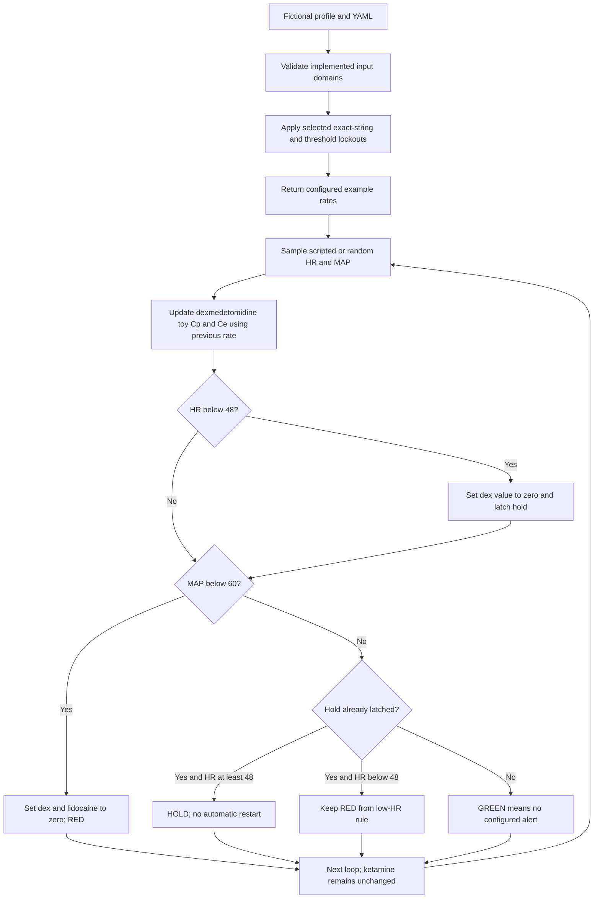

# Smart NOA: paired synthetic examples and decision flow
27 October 2026 | Additive teaching supplement to [MANUSCRIPT.md](MANUSCRIPT.md)

These examples explain the existing software and selected literature. They are entirely fictional, independent of clinical encounters and shadowing notes. No drugs were administered. They are not a standardized anesthetic regimen, patient-specific recommendations, proof of safety, or a replacement for clinical assessment. The male and female labels describe fictional adults; they do not create a sex-based dosing rule.

For broader procedure-specific choices, see [Anesthesia options, standards and synthetic cases](ANESTHESIA_OPTIONS_AND_CASES.md). That companion covers clinical discussion outside the simulation.

## 1. What the program actually does
The program reads a fictional profile and config.yaml, applies a few exact-string profile rules, returns configured per-kg rate values, and repeatedly updates a dexmedetomidine toy concentration model. It samples synthetic HR and MAP independently of concentrations and changes selected in-memory rates when thresholds are crossed. There is no monitor, pump, IV line, patient connection, or clinical feedback model.

| Feature | Implemented | Missing clinical capability |
|---|---|---|
| Profile | Age, weight, ASA class, eGFR, allergy/comorbidity strings | Sex, height, pregnancy, hepatic function, frailty, actual examination |
| Profile-dependent logic | Selected dexmedetomidine cardiac strings; ketorolac renal/allergy strings; dexmedetomidine age branch | Comprehensive contraindications, drug interactions, risk assessment |
| Drug amounts | Configured dexmedetomidine, ketamine and lidocaine rate values | Selecting an appropriate drug, route, dose, concentration or delivery device |
| Concentrations | One central compartment plus effect-site state for dexmedetomidine | Validated population PK/PD, measured concentrations, ketamine/lidocaine PK |
| Observations | Random HR and MAP, or scripted values in this supplement | Pain, nociception, EEG, ventilation, oxygenation, sensor quality, ECG rhythm |
| Rule actions | Selected rates set to zero, hold latch | Clinical diagnosis, rescue treatment, comprehensive stop policy, restart authorization |

ASA class is stored but does not alter these rules. eGFR only affects the ketorolac example rule; it does not adjust dexmedetomidine, ketamine or lidocaine. Comorbidity and allergy matching is case-sensitive and incomplete. "No configured lockout" is not clearance.

## 2. Literature context and administration concepts
Clinical publications inform the discussion below; they do not validate config.yaml or the simulator. Different drugs serve different purposes. These are separate source contexts, not instructions to combine all listed agents.

| Agent | Peer-reviewed source context | Administration concept and applicability limit |
|---|---|---|
| Dexmedetomidine | Weerink et al. [D1], a pharmacology review, describes US ICU maintenance 0.2–0.7 mcg/kg/hour and procedural-sedation maintenance 0.2–1 mcg/kg/hour | IV infusion, titrated to a defined sedation endpoint in the appropriate monitored setting. Those indications do not establish a general-anesthesia or universal opioid-free regimen. The code implements no loading infusion or clinical sedation assessment. |
| Ketamine | Schwenk et al. [K1], acute-pain consensus guideline, describes subanesthetic IV infusions often started at 0.1–0.2 mg/kg/hour | Selection depends on indication, monitoring, contraindications and clinician assessment. This is analgesic-adjunct context, not an induction dose. The program merely stores 0.2; it does not monitor analgesia or ketamine effects. |
| Lidocaine | Foo et al. [L1], international consensus statement, describes an IV loading infusion of no more than 1.5 mg/kg over 10 minutes and subsequent infusion no more than 1.5 mg/kg/hour for at most 24 hours, using ideal body weight | High-risk medication requiring governance, informed consent, monitoring and reassessment; dedicated infusion access/device. Avoid overlapping local-anesthetic interventions; the consensus includes separation from nerve/fascial-plane blocks. The program has no ideal-body-weight calculation, loading phase, cumulative exposure, toxicity detection or block-timing check. |
| Propofol, rocuronium, fentanyl | Outside the implemented controller | All return UNASSESSED. There is no dosing or monitoring model for these agents. Do not infer that the program delivers hypnosis, paralysis or opioid rescue. A regimen containing fentanyl is not opioid-free. |

A source-supported clinical assessment would determine whether any agent is appropriate before dose arithmetic. Source ranges are not targets to pursue. We do not add a pump mL/hour setting because no drug preparation or verified concentration is modeled.

## 3. Paired adult profiles
M1 is a fictional 40-year-old male, 180 cm, 80 kg; F1 is a fictional 40-year-old female, 165 cm, 60 kg, not pregnant in the narrative. Both have illustrative ASA II, eGFR 90, no listed allergies or comorbidities, and no stated hepatic disease. They are learning profiles for a hypothetical elective abdominal procedure; no anesthetic suitability or complete plan is established.

Height, sex, pregnancy and hepatic history are narrative metadata only. Neither is passed to Patient. Changing the sex label alone cannot change the output. The two weights were chosen for arithmetic contrast, not because they are normative male/female weights.

| Configured simulation input | M1 arithmetic | F1 arithmetic |
|---|---|---|
| Dexmedetomidine 0.5 mcg/kg/hour | 0.5 × 80 = 40 mcg/hour; ÷60 = 0.666667 mcg/minute | 0.5 × 60 = 30 mcg/hour; ÷60 = 0.5 mcg/minute |
| Ketamine 0.2 mg/kg/hour | 0.2 × 80 = 16 mg/hour | 0.2 × 60 = 12 mg/hour |
| Lidocaine 1.5 mg/kg/hour | 1.5 × 80 = 120 mg/hour | 1.5 × 60 = 90 mg/hour |

These numbers reproduce config.yaml, not clinical prescriptions. In particular the lidocaine arithmetic uses the code's supplied weight, not a verified ideal-body-weight input. It must not be presented as implementation of [L1]. None of the three amounts establishes that combined administration is appropriate. The program computes only the dexmedetomidine mcg/minute conversion internally; the other mass/hour figures are transparent arithmetic in the example script.

## 4. Step-by-step software trace
The harness uses the unchanged monitor_and_control method with scripted random readings and sleep disabled. Each call below advances one model second; call-local printed T+0s resets, so the JSON supplies a cumulative step index.

| Step | Scripted HR / MAP | Status | Dex / ketamine / lidocaine rate values after rule checks |
|---|---|---|---|
| 1 | 80 beats/min / 80 mmHg | GREEN | 0.5 / 0.2 / 1.5 |
| 2 | 40 beats/min / 50 mmHg | RED | 0 / 0.2 / 0 |
| 3 | 80 beats/min / 80 mmHg | HOLD | 0 / 0.2 / 0 |
| Explicit subsequent generate_starting_rates() call | No new observation | Status not recomputed | 0 / 0 / 0 |

Units in the final column remain mcg/kg/hour for dexmedetomidine and mg/kg/hour for the other two agents. GREEN means no configured alert on that step, not a clinically safe state. A low-HR rule uses HR <48; a separate low-MAP rule uses MAP <60. Both execute at step 2, so low HR cannot mask the low-MAP action.

**The hold is incomplete:** ketamine stays at 0.2 in the loop, even after the hold latches. The explicit rate-generation method zeros all three when it sees an existing latch. It is not automatically called by the loop. There is no implemented unlatch/restart policy. This is a limitation to teach, not a comprehensive infusion shutdown or rescue protocol.

The model update occurs before each observation's rule action. Step 2 therefore uses the previous nonzero dexmedetomidine rate for that step before zeroing it. An in-memory zero does not remove drug already present or cause instant recovery. At step 3, toy Cp falls slightly while Ce continues rising because it is still below Cp.

For both M1 and F1, toy Cp after steps 1–3 is approximately 0.000173611, 0.000347106 and 0.000346875 ng/mL. Ce is approximately 2.89352e-7, 8.67380e-7 and 1.44406e-6 ng/mL. These are unvalidated numerical states, not therapeutic targets or measured concentrations. Equal weight-normalized inputs and a volume proportional to weight cause weight to cancel mathematically; the matched concentrations do not demonstrate equivalent responses in male and female patients.

## 5. Older, higher-risk variants
M2 and F2 retain the respective 80/60 kg weights and narrative sex/height, but are aged 78 with eGFR 24 and the exact comorbidity string "Heart Block". Illustrative ASA III is supplied for these fictional variants; it is stored but does not alter the rules. This is not an assessment of a real patient.

For both, the configured cardiac-string rule sets dexmedetomidine to zero from initialization, and the eGFR rule locks the ketorolac adjunct message. Ketamine and lidocaine still start at 0.2 and 1.5 per kg/hour. Those unchanged values expose missing risk adaptation; they are not proposed treatment for these profiles. Dexmedetomidine toy concentrations stay zero, yet the scripted low-HR/low-MAP event still triggers RED. This demonstrates threshold logic independent of a concentration estimate.

Age alone above 65 would select the configured 0.25 dexmedetomidine value if the cardiac lockout were absent. That exact 50% age adjustment is a programming choice, not a guideline-derived geriatric rule. At age exactly 65, eGFR exactly 30, HR exactly 48 and MAP exactly 60, none of these respective strict-threshold branches activates. The harness records this boundary to prevent false assumptions about what the code checks.

## 6. Decision flows
### Existing software flow


### Guideline-informed educational discussion, outside this software
Identify procedure and goals → review applicable source population and current local policy → assess contraindications, organ function, interactions, weight metric and monitoring → clinician selects or rejects an intervention → verify units and administration arrangements → observe intended effect and adverse effects → clinician reassesses.

This conceptual sequence is not an executable dosing algorithm. Patient deterioration requires clinical assessment and an established response process; the simulator supplies neither diagnosis nor rescue decisions.

## 7. What advantages and safeguards can honestly be described?
| Demonstrated educational property | Evidence in this repository | What it does not establish |
|---|---|---|
| Inspectable rules and units | YAML, source and four reproducible traces | Appropriate regimen selection or dosing accuracy |
| Repeatable simultaneous-event demonstration | Step 2 activates both rules | Prevention of bradycardia/hypotension |
| Persistent selected-rate hold | Step 3 and explicit regeneration | Complete shutdown, residual-drug management or safe restart |
| Rejection of invalid numerical inputs and intermediate overflow | Existing regression suite | Detection of plausible but wrong clinical inputs or sensor artifacts |
| Unknown agents labeled UNASSESSED | Three unsupported agents in JSON | Full drug knowledge or contraindication coverage |
| Transparent limitations | Same Cp/Ce across pairs; unchanged ketamine; exact-boundary example | Clinical validation, equity assessment, effectiveness or regulatory clearance |

Clinical benefit remains untested. The POFA trial [P1] did not establish a blanket safety advantage for its dexmedetomidine-based opioid-free strategy and stopped early after severe bradycardia. It did not evaluate Smart NOA or these toy thresholds.

## 8. Reproduce and inspect
From the repository root, after installing requirements:

```sh
python -m unittest discover -v
python example_walkthrough.py > EXAMPLE_RESULTS.json
```

The harness scripts only input readings and time.sleep using unittest.mock; it calls the existing controller logic. Assertions check event order, the incomplete ketamine hold, the regeneration behavior, unsupported drugs, exact boundaries and equal toy concentrations for matched per-kg inputs. See [EXAMPLE_RESULTS.json](EXAMPLE_RESULTS.json) and [example_walkthrough.py](example_walkthrough.py). This is software verification, not clinical testing. No production control logic was changed by this supplement.

## 9. Peer-reviewed DOI sources and claim mapping
- **[D1]** Weerink MAS et al. Clinical Pharmacokinetics and Pharmacodynamics of Dexmedetomidine. *Clinical Pharmacokinetics*. 2017;56:893–913. [DOI 10.1007/s40262-017-0507-7](https://doi.org/10.1007/s40262-017-0507-7). Review; section 3 supports the distinct maintenance-dose contexts. Does not validate this model or its constants.
- **[K1]** Schwenk ES et al. Consensus Guidelines on the Use of Intravenous Ketamine Infusions for Acute Pain Management. *Regional Anesthesia and Pain Medicine*. 2018;43:456–466. [DOI 10.1097/AAP.0000000000000806](https://doi.org/10.1097/AAP.0000000000000806). Consensus guideline; question 2 supports the cited subanesthetic infusion context, not a complete anesthesia plan.
- **[L1]** Foo I et al. The use of intravenous lidocaine for postoperative pain and recovery: international consensus statement on efficacy and safety. *Anaesthesia*. 2021;76:238–250. [DOI 10.1111/anae.15270](https://doi.org/10.1111/anae.15270). Consensus recommendations support the weight metric, delivery/monitoring concepts, limits and local-anesthetic overlap discussion.
- **[P1]** Beloeil H et al. Balanced Opioid-free Anesthesia with Dexmedetomidine versus Balanced Anesthesia with Remifentanil for Major or Intermediate Noncardiac Surgery. *Anesthesiology*. 2021;134:541–551. [DOI 10.1097/ALN.0000000000003725](https://doi.org/10.1097/ALN.0000000000003725). Randomized trial; supports the caution about assuming clinical benefit, not simulator performance.

Sources checked 27 October 2026 using publisher/PubMed/PMC records and available source text. Source types are identified because a consensus recommendation, pharmacology review and randomized trial answer different questions. Software-behavior claims are evidenced by the code and traces rather than assigned a clinical DOI. This is selected-source teaching material, not a systematic evidence review.
