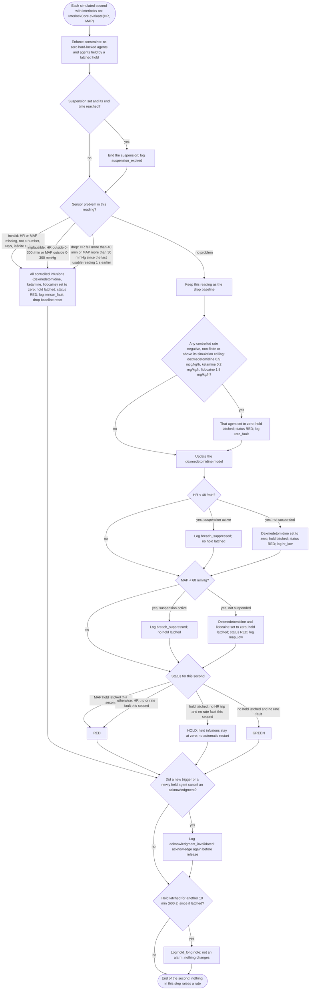
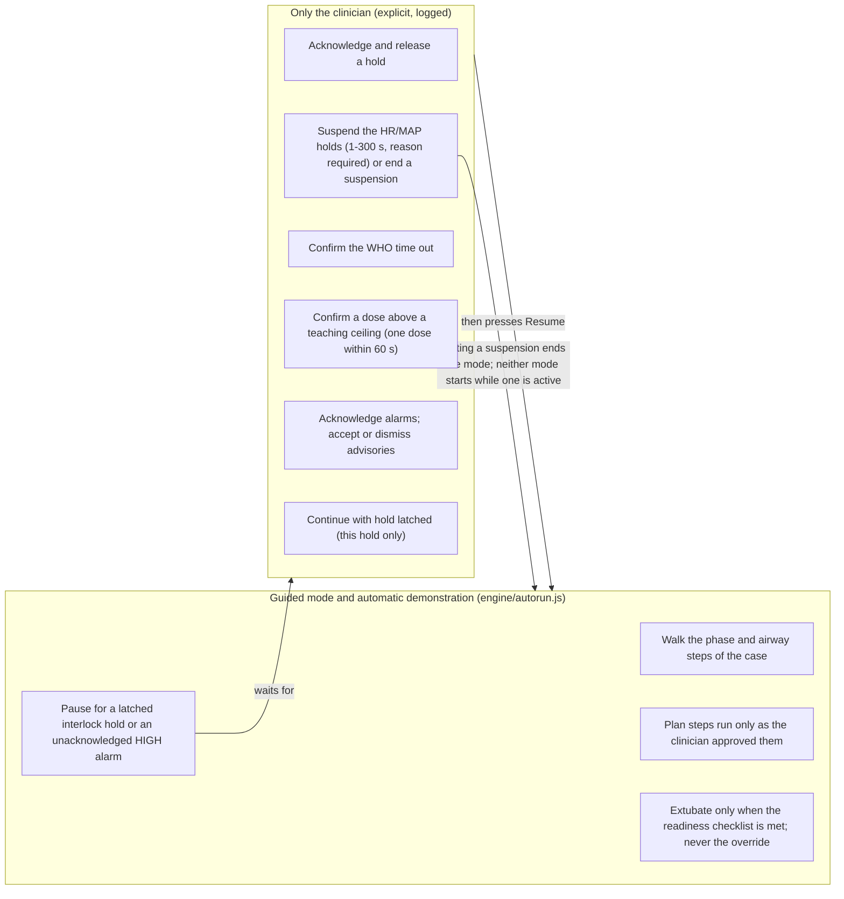
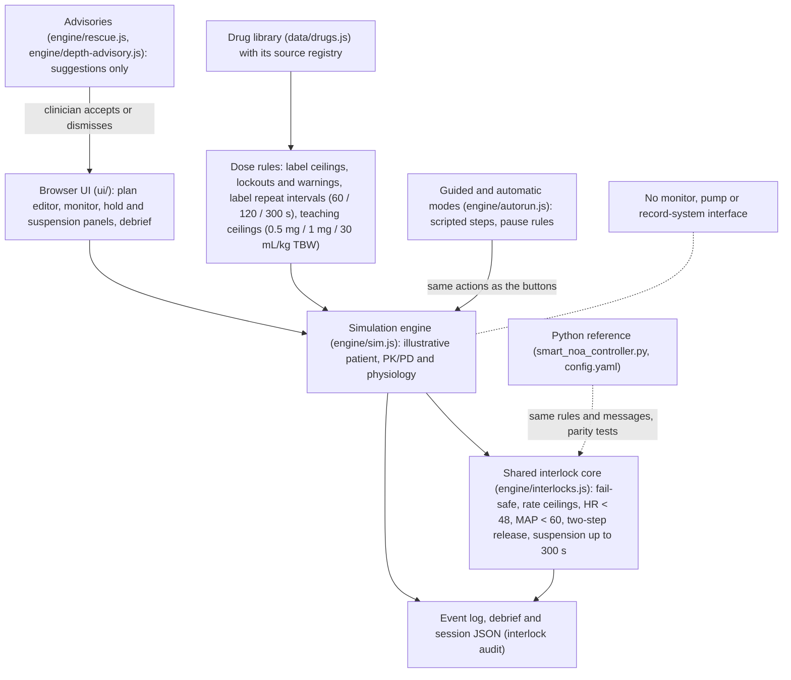
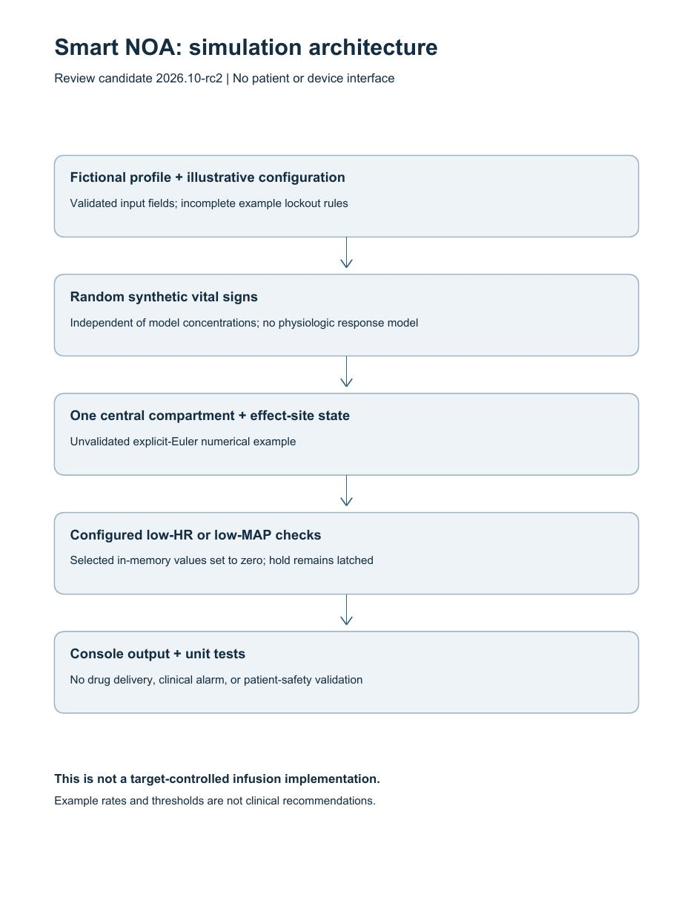

# How the safety logic works, and why these design principles reduce risk

> **Educational work by a pre-medical student — not medical advice.** Not a clinical protocol, prescription, or patient handout, and not for patient care. See [DISCLAIMER](DISCLAIMER.md).

Written 7 November 2026. Smart NOA is an **educational simulation with fictional patients**. It is not clinically validated, not a medical device and not clinical decision support, and it has no monitor, pump or record-system interface. This page explains the safety logic this simulation demonstrates, and what published evidence and standards say about these design principles in real anaesthesia practice. It does **not** claim that this simulation, or the Python program it mirrors, lowers clinical risk, liability, malpractice exposure or insurance costs for anyone; that it is safer than clinicians or than any real device; or that it is suitable for patient care.

**This simulation does not reduce anyone's liability or insurance costs; real reductions depend on validated, regulated devices and institutional practice.**

The title's "reduce risk" refers to what the cited literature and standards say about these principles in real, regulated practice — not to anything this software does.

Contents: [1. The logic](#1-the-logic) · [2. Evidence and standards behind each principle](#2-evidence-and-standards-behind-each-principle) · [3. Liability and insurance, in general terms](#3-liability-and-insurance-in-general-terms) · [4. Limits](#4-limits) · [5. Sources](#5-sources) · [6. How this page was made](#6-how-this-page-was-made)

## 1. The logic

The rules below are implemented identically in the Python reference program ([`smart_noa_controller.py`](smart_noa_controller.py) with [`config.yaml`](config.yaml)) and in the web simulator's shared decision core ([`simulator/engine/interlocks.js`](simulator/engine/interlocks.js) `InterlockCore`); automated parity tests compare their decisions and event messages. The dose rules (repeat intervals, teaching ceilings) exist only in the web simulator.

Every number in the diagrams and in the table below is **generated from the engine configuration** by [`simulator/tools/safety-diagrams.mjs`](simulator/tools/safety-diagrams.mjs) (`NOA_CONFIG`, the mirror of `config.yaml`; `TIMING_CONFIG`; `TEACHING_CEILINGS`); `node simulator/tools/safety-diagrams.mjs --check` and an automated test fail if the page and the code disagree. All of these numbers are simulation settings, not clinical standards.

<!-- safety-diagrams:numbers:start -->
| Number in the diagrams | Value | Read from |
|---|---|---|
| HR hold threshold (strict "<") | 48 /min | `config.yaml` `hemodynamic_thresholds.hr_critical_low` (`NOA_CONFIG`) |
| MAP hold threshold (strict "<") | 60 mmHg | `hemodynamic_thresholds.map_critical_low` |
| Sensor plausibility limits | HR 0–300 /min, MAP 0–300 mmHg | `sensor_plausibility` (simulation limits, not clinical standards) |
| Sudden-drop limits (1-s drop, strict ">") | HR 40 /min, MAP 30 mmHg | `sensor_plausibility.*_max_drop_per_sec` |
| Simulation rate ceilings | dexmedetomidine 0.5 mcg/kg/h, ketamine 0.2 mg/kg/h, lidocaine 1.5 mg/kg/h | `simulation_rate_ceilings` (software ceilings, not clinical maxima) |
| Longest suspension | 1–300 s | `interlock_suspension_max_sec` (simulator convention) |
| Long-hold note interval | 600 s (10 min) | `interlock_long_hold_advisory_sec` (simulator convention) |
| Label repeat intervals (clinician repeat refused) | phenylephrine IV 60 s, glycopyrrolate IV 120 s (outside emergence), epinephrine IM/SC 300 s | `TIMING_CONFIG` (lower bounds of the label intervals) |
| Teaching ceilings (simulator conventions) | epinephrine IV boluses 0.5 mg, glycopyrrolate boluses 1 mg, crystalloid 30 mL/kg TBW; one confirmation covers one dose within 60 s | `TEACHING_CEILINGS` |
| Depth-low advisory (text only) | index below 40 for ≥ 300 s | `TIMING_CONFIG.DEPTH_LOW_ADVISORY_SUSTAIN_SEC` |
<!-- safety-diagrams:numbers:end -->

### 1.1 What triggers a hold, and why a bad reading zeroes everything (fail-safe)

Each simulated second the engine re-applies the hard lockouts and any latched hold, then looks at the heart-rate (HR) and mean-arterial-pressure (MAP) reading. A reading it cannot trust — missing, not a number, outside the plausibility limits, or falling faster than the drop limits allow — is treated as **unusable**, and all three controlled infusions (dexmedetomidine, ketamine, lidocaine) go to zero. The reason is simple: a rule that compares a number with a threshold silently passes when the number is garbage (a missing value is not "below 48"), so the only safe default when the input cannot be trusted is the state that adds no drug. Only when the reading is usable are the rate ceilings and the HR/MAP thresholds applied. The tree below follows `InterlockCore.evaluate()` in the order the code runs it.

<!-- safety-diagrams:decision-tree:start -->

**Text alternative.** Every simulated second, while interlocks are on, the engine first re-zeroes every hard-locked agent and every agent held by a latched hold, then ends a suspension whose time is up (logged). It then checks the reading. If HR or MAP is unusable — missing, not a number, NaN, infinite or boolean; outside HR 0–300 /min or MAP 0–300 mmHg; or a drop of more than 40 /min (HR) or 30 mmHg (MAP) since the previous usable reading one second earlier — all three controlled infusions go to zero, the hold latches, the status is RED and the rest of the threshold rules are skipped (fail-safe). Otherwise the reading becomes the drop baseline; any rate that is negative, non-finite or above its simulation ceiling (dexmedetomidine 0.5 mcg/kg/h, ketamine 0.2 mg/kg/h, lidocaine 1.5 mg/kg/h) is set to zero and latches the hold (RED); the dexmedetomidine model updates; then HR < 48 /min (dexmedetomidine) and MAP < 60 mmHg (dexmedetomidine and lidocaine) are checked in that order: each either zeroes its agents, latches the hold and sets RED, or — only while an explicit suspension is active — is logged as a suppressed breach without a latch. The status is RED after a MAP trip; HOLD when a hold is latched and nothing new tripped on HR or rate; GREEN when no hold is latched and there is no rate fault; otherwise RED. Finally, if a new trigger or a newly held agent cancelled an acknowledgment, that is logged, and a non-blocking long-hold note is logged every 10 minutes a hold stays latched. Ketamine is not part of the HR/MAP rules. Nothing in the step raises a rate.
<!-- safety-diagrams:decision-tree:end -->

### 1.2 Why release takes two steps, and why nothing restarts automatically

A hold never clears itself, even if the next reading is normal. Releasing it takes two explicit, logged actions: **acknowledge** (the clinician states the cause has been reviewed) and then **release**. The acknowledgment belongs to the current hold: a new trigger or a newly held agent cancels it, and each acknowledgment can be used for one release only, so an old acknowledgment cannot release a hold whose cause has changed. After the release no rate is restored — the held infusions stay at zero until the clinician restarts them. Every release shows the line "Releasing this hold is a clinician decision. The simulation does not assess whether restart is appropriate." A non-blocking note is logged every 10 minutes while a hold stays latched, so a forgotten hold is visible without being an alarm.

```mermaid
stateDiagram-v2
  state "GREEN: no hold latched" as Green
  state "Latched: RED on the trip, then HOLD; held infusions at zero; needs an acknowledgment" as Latched
  state "Acknowledged: cause reviewed by the clinician; still latched, infusions still zero" as Acked
  state "Released: hold cleared; held infusions still zero, nothing restored" as Released
  [*] --> Green
  Green --> Latched: sensor fault, rate fault, HR < 48 or MAP < 60 (not suspended)
  Latched --> Latched: release attempted without acknowledgment (refused)
  Latched --> Acked: acknowledge_hold(by, note)
  Acked --> Latched: new trigger or newly held agent (acknowledgment cancelled, logged)
  Acked --> Acked: same trigger again (acknowledgment kept)
  Acked --> Released: resume_hold(by) uses the acknowledgment once
  Released --> Green: next second with no trip
  Released --> Latched: next second trips again (a new hold, needs a new acknowledgment)
```

<!-- safety-diagrams:hold-lifecycle:start -->

**Text alternative.** A case starts GREEN. A sensor fault, a rate fault, or HR < 48 / MAP < 60 outside a suspension latches a hold: the status is RED on that second and HOLD afterwards, and the held infusions stay at zero. Release takes two explicit steps. First the clinician acknowledges the hold (`acknowledge_hold`) after reviewing its cause; a release attempted without that acknowledgment is refused. While acknowledged the hold is still latched; the same trigger firing again keeps the acknowledgment, but a new trigger or a newly held agent cancels it (logged) and the hold needs a new acknowledgment. Then the clinician releases it (`resume_hold`), which uses the acknowledgment once. After release nothing is restored: held infusions stay at zero until the clinician restarts them, and the status becomes GREEN at the next second only if nothing trips; if something trips again it is a new hold that needs a new acknowledgment. A suspension never releases a hold, and the long-hold note (every 10 min) changes nothing.
<!-- safety-diagrams:hold-lifecycle:end -->

### 1.3 Why a suspension is time-limited, needs a reason, is logged, and cannot override the fail-safe

Sometimes a clinician knowingly accepts a low reading for a short time. The simulator models that as an explicit **suspension** of the HR/MAP holds only: it lasts 1–300 s, needs a written reason, shows a banner with a countdown, logs every suppressed breach, and expires on its own. It never suspends the sensor fail-safe, the rate ceilings, the lockouts or a hold that is already latched, and it never releases a hold or restores a rate — an override of a threshold should not also switch off the protection against untrustworthy data. Starting a suspension ends guided or automatic mode, and neither mode can be started while one is active (their start buttons are disabled and show "Interlocks are suspended (manual override). End the suspension, or let it expire, before starting guided or automatic mode.").

### 1.4 Why the automatic modes may not act for the clinician

Guided mode and the automatic demonstration are scripted walk-throughs of the same buttons a user can press. Every decision that is a clinician's responsibility stays with the clinician, and the modes stop and wait when such a decision is needed.

<!-- safety-diagrams:clinician-loop:start -->

**Text alternative.** Guided mode and the automatic demonstration only walk the case's phase and airway steps, run the plan steps the clinician approved, extubate only when the readiness checklist is met (never with the override), and pause for a latched interlock hold or an unacknowledged HIGH-priority alarm. They never acknowledge or release a hold, never suspend the interlocks or end a suspension, never confirm the WHO time out, never confirm a dose above a teaching ceiling (a planned step above one is refused and skipped), never acknowledge alarms and never accept an advisory: each of these is an explicit, logged clinician action. "Continue with hold latched (this hold only)" is also the clinician's choice and does not release the hold. Starting a suspension ends either mode, and neither mode can be started while a suspension is active. Medium and low alarms and the text-only depth-low advisory (index below 40 for ≥ 300 s) do not pause them.
<!-- safety-diagrams:clinician-loop:end -->

### 1.5 Why dose refusals and teaching ceilings exist

- **Label repeat intervals.** A clinician-entered repeat bolus sooner than the label's stated interval is refused with the time remaining (phenylephrine IV 60 s, glycopyrrolate IV 120 s outside emergence, epinephrine IM/SC 300 s — the lower bound of each label interval); a planned repeat waits instead.
- **Teaching ceilings.** Where no label or guideline states a cumulative maximum, the simulator applies a **simulator convention** — IV epinephrine boluses 0.5 mg, glycopyrrolate boluses 1 mg, crystalloid 30 mL/kg — above which a dose is refused until the clinician confirms it (one dose, logged). These are "stop and think" points, not clinical limits, and the automatic modes never confirm them.
- **Lockouts and cautions.** Label maxima are hard stops; contraindication lockouts block a drug. A documented dexamethasone allergy is a lockout by simulator convention (the current label's only contraindication is systemic fungal infections), and acetaminophen at eGFR ≤ 30 shows the label's severe-renal-impairment caution (eGFR standing in for creatinine clearance is a simulator convention). A command with no sourced regimen at all (for example a "bolus" of an inhaled agent) is refused rather than guessed.

The aim is the one described for real anaesthesia medication safety: make the wrong dose harder to give by accident and make a deliberate exception visible.

### 1.6 Why everything is time-stamped

Every automatic zeroing, latch, acknowledgment, release, suspension start, end and expiry, suppressed breach, refusal and confirmation is written to an event log with simulated time, code, status, agents and the exact reason. The debrief and the downloadable session JSON (`summary.interlockAudit`) list them. In real practice an audit trail is what lets a team reconstruct what happened and learn from it (section 2); here it lets a learner check exactly what the rules did.

### 1.7 Architecture

<!-- safety-diagrams:architecture:start -->

**Text alternative.** The browser UI drives a single simulation engine with an illustrative patient, PK/PD and physiology model. Every dose passes the dose rules — label ceilings, contraindication lockouts and warnings, label repeat intervals (phenylephrine 60 s, glycopyrrolate 120 s, IM/SC epinephrine 300 s) and the teaching ceilings (epinephrine IV boluses 0.5 mg, glycopyrrolate 1 mg, crystalloid 30 mL/kg TBW) — fed by the drug library and its source registry. Each simulated second the engine calls the shared interlock core, which implements the same rules and messages as the Python reference controller (checked by parity tests): the sensor fail-safe, rate ceilings, HR < 48 and MAP < 60 holds, the two-step release and the suspension of up to 300 s. Guided and automatic modes use the same actions as the on-screen buttons and pause under fixed rules; advisories only suggest, and the clinician accepts or dismisses them. Everything is written to a time-stamped event log that feeds the debrief and the downloadable session JSON. There is no monitor, pump or record-system interface.
<!-- safety-diagrams:architecture:end -->

*Architecture figure from 29 October 2026 (the date of commit aa522ab, which added it to this repository); predates the November 2026 interlock hardening; see the current diagram in SAFETY_DESIGN.md (above). The image is kept unchanged for the record.*

## 2. Evidence and standards behind each principle

Each source below was checked through web-search records of its publisher, index or summary pages; the full text could not be opened from the build environment (the network proxy blocked the publisher and index hosts). Each is therefore marked **not yet confirmed against the full source**, and each statement is limited to what those records show. None of these sources evaluated Smart NOA.

| Principle in the simulation | What published evidence and standards say about real practice | Sources |
|---|---|---|
| Design for human error; make wrong doses harder (fail-safe, dose refusals, ceilings) | A critical-incident study of anaesthesia mishaps found human error involved in most of the preventable incidents it collected (82%), with equipment failure in 14%; syringe swaps and breathing-circuit disconnections were among the common incidents. A prospective study at two hospitals reported about one drug administration error per 133 anaesthetics, the largest categories being incorrect doses and substitutions of IV boluses. An observational study found about 1 in 20 perioperative medication administrations involved a medication error and/or adverse drug event, most judged preventable. An APSF consensus conference called for a "new paradigm" for operating-room medication safety built on standardization, technology, pharmacy (prefilled/premixed) and culture. | [C1] [W1] [N1] [A1] |
| A clinician stays in the loop; the software never acts for them | The ASA monitoring standards require qualified anaesthesia personnel to be continuously present to monitor the patient during anaesthesia. FDA guidance on clinical decision support distinguishes software that supports a clinician's independent review from software that directs care; claiming a clinical function is part of what can make software a regulated device. | [ASA] [FDA] |
| Explicit checkpoints before critical steps (WHO time-out is the clinician's) | In a before-and-after study in eight hospitals, introduction of the WHO Surgical Safety Checklist (sign-in, time-out, sign-out) was associated with lower rates of death (1.5% to 0.8%) and inpatient complications (11.0% to 7.0%). | [H1] |
| Alarms with priorities, few interruptions, nothing hidden (holds pause automatic modes; advisories are text only) | The Joint Commission's Sentinel Event Alert 50 identified alarm fatigue as the most common contributing factor in alarm-related sentinel events and recommended that hospitals manage alarm-equipped devices and their settings. IEC 60601-1-8 is the international standard for alarm systems in medical electrical equipment. | [TJC] [IEC-A] |
| Time-stamped records and incident review | The ASA Closed Claims Project analyses insurers' closed malpractice claim files to identify the main patterns of anaesthesia-related injury and to provide data for safety strategies. | [CC1] |
| Risk analysis and controlled software development for real devices | Real medical devices are developed under a risk-management process (ISO 14971) and a software life-cycle process (IEC 62304). This simulation has followed neither and has not been assessed against either. | [ISO] [IEC-S] |
| What validated closed-loop systems require and show | A meta-analysis of randomized trials (12 studies, 1,284 patients) reported that closed-loop, processed-EEG-guided delivery of total IV anaesthesia used less propofol for induction, kept the target depth more of the time and shortened recovery compared with manual control. Those were purpose-built systems evaluated in clinical trials. **This simulation is not such a system**: it does not titrate anaesthesia, it has not been evaluated in patients, and its interlocks only stop or refuse. | [P1] |

## 3. Liability and insurance, in general terms

**This simulation does not reduce anyone's liability or insurance costs; real reductions depend on validated, regulated devices and institutional practice.**

In general, the sources above describe what risk management in anaesthesia is built on: standard-compliant monitoring with a qualified clinician present [ASA], checklists at critical points [H1], medication-safety measures such as standardization and technology [A1], managed alarm systems [TJC], documented records that allow incidents to be reconstructed, and systematic review of incidents and closed claims [CC1]. The Closed Claims Project itself was started in the 1980s, when anaesthesia malpractice insurance had become very hard to afford, to learn which injuries led to claims and to inform prevention [CC1]. For devices, documented risk controls follow ISO 14971 and IEC 62304 [ISO] [IEC-S].

No verified source found for this page states a premium saving or a liability reduction from any of these measures, so none is given. How an individual insurer or institution weighs such measures is outside the scope of this educational page. Educational software that claims a clinical benefit can bring itself under medical-device regulation [FDA]; that is one more reason this page makes no such claim.

## 4. Limits

The same caveats as the [model card](simulator/MODEL_CARD.md):

- **Not validated.** No external validation has been performed, and simulator outputs have not been compared with patient data. Passing tests shows that the code does what it is written to do, not that it is clinically safe or effective.
- **Illustrative physiology.** Physiology and PK/PD are illustrative; most model constants are author estimates. The interlock thresholds, plausibility and drop limits, suspension length and long-hold interval are simulation settings, not clinical standards.
- **Simulator conventions are labelled.** Teaching ceilings, the dexamethasone-allergy lockout, eGFR as a stand-in for creatinine clearance, the advisory agent-selection rule and many timings are simulator conventions, each labelled as such in the code, the model card and the source registry.
- **No clinical sign-off.** No independent clinical (anaesthesiologist) review has been recorded.
- The program has no device interface and must not be connected to equipment or used with real patient information.

## 5. Sources

Verification method for every entry: web-search result records (titles, abstracts or summaries on index, publisher, society or secondary pages) seen on 2026-11-07. Full-text fetches failed (the session's network proxy could not reach pubmed.ncbi.nlm.nih.gov, pmc.ncbi.nlm.nih.gov, qualitysafety.bmj.com or apsf.org). No source was opened in full, so none is marked "confirmed against the full source".

- **[C1]** Cooper JB, Newbower RS, Long CD, McPeek B. Preventable anesthesia mishaps: a study of human factors. *Anesthesiology*. 1978;49(6):399–406. doi:10.1097/00000542-197812000-00004 (as listed by PubMed). Records seen: PubMed and AHRQ PSNet listings (47 interviews, 359 preventable incidents; human error 82%, equipment failure 14%). **Not yet confirmed against the full source.**
- **[W1]** Webster CS, Merry AF, Larsson L, McGrath KA, Weller J. The frequency and nature of drug administration error during anaesthesia. *Anaesthesia and Intensive Care*. 2001;29(5):494–500. Records seen: CiNii and university repository listings with the abstract (7,794 forms from 10,806 anaesthetics; error rate 0.0075 per anaesthetic, about 1 in 133; incorrect doses and substitutions each 20%). **Not yet confirmed against the full source.**
- **[N1]** Nanji KC, Patel A, Shaikh S, Seger DL, Bates DW. Evaluation of perioperative medication errors and adverse drug events. *Anesthesiology*. 2016;124(1):25–34. doi:10.1097/ALN.0000000000000904. Records seen: AHRQ PSNet listing, a news release and an editorial (277 operations; about 1 in 20 administrations involved a medication error and/or adverse drug event; most preventable). Reported counts differ between records, so no count is quoted here. **Not yet confirmed against the full source.**
- **[A1]** Anesthesia Patient Safety Foundation. "Medication Safety in the Operating Room: Time for a New Paradigm" consensus conference, 26 January 2010; reported by Eichhorn JH in the *APSF Newsletter*, Spring 2010. Records seen: apsf.org article listings (four elements: standardization, technology, pharmacy/prefilled/premixed, culture — "STPC"). **Not yet confirmed against the full source.**
- **[ASA]** American Society of Anesthesiologists. Standards for Basic Anesthetic Monitoring. Last amended 15 October 2025. https://www.asahq.org/standards-and-practice-parameters/standards-for-basic-anesthetic-monitoring. Records seen: the asahq.org page record (Standard I: qualified anaesthesia personnel continuously present to monitor the patient; applies to general and regional anaesthesia and monitored anaesthesia care). The same standard is source S22 of the simulator's registry. **Not yet confirmed against the full source.**
- **[H1]** Haynes AB, Weiser TG, Berry WR, et al. A surgical safety checklist to reduce morbidity and mortality in a global population. *N Engl J Med*. 2009;360(5):491–499. doi:10.1056/NEJMsa0810119. Records seen: PubMed and AHRQ PSNet listings and a summary page (eight hospitals; 3,733 patients before and 3,955 after; death 1.5% to 0.8%, inpatient complications 11.0% to 7.0%). **Not yet confirmed against the full source.**
- **[TJC]** The Joint Commission. Sentinel Event Alert, Issue 50: Medical device alarm safety in hospitals. 8 April 2013. https://www.jointcommission.org/sea_issue_50. Records seen: the jointcommission.org page record and contemporaneous news summaries (alarm fatigue the most common contributing factor; recommendations on alarm management). **Not yet confirmed against the full source.**
- **[IEC-A]** IEC 60601-1-8, *Medical electrical equipment — Part 1-8: General requirements for basic safety and essential performance — Collateral standard: General requirements, tests and guidance for alarm systems in medical electrical equipment and medical electrical systems*, edition 2 with amendments 1 (2012) and 2 (2020). Cited by title and edition only; records seen: certification-body and standards-shop listings. **Not yet confirmed against the full source.**
- **[CC1]** Cheney FW. The American Society of Anesthesiologists Closed Claims Project: what have we learned, how has it affected practice, and how will it affect practice in the future? *Anesthesiology*. 1999;91(2):552–556. doi:10.1097/00000542-199908000-00030. Records seen: PubMed listing (no abstract) and the opening of the article PDF in a search record and APSF summaries (project started in 1984, when professional liability insurance had become hard to afford; claims from insurers' closed files analysed to identify injury patterns and provide data for safety strategies). **Not yet confirmed against the full source.**
- **[ISO]** ISO 14971:2019, *Medical devices — Application of risk management to medical devices*, third edition. Cited by title and edition only; records seen: national standards-body listings. **Not yet confirmed against the full source.**
- **[IEC-S]** IEC 62304:2006 + Amendment 1:2015, *Medical device software — Software life cycle processes*. Cited by title and edition only; records seen: standards-shop listings. **Not yet confirmed against the full source.**
- **[FDA]** U.S. Food and Drug Administration. *Clinical Decision Support Software: Guidance for Industry and Food and Drug Administration Staff*. Final guidance, 28 September 2022. https://www.fda.gov/regulatory-information/search-fda-guidance-documents/clinical-decision-support-software. Records seen: the FDA document record and law-firm summaries (four statutory criteria for non-device CDS; software must support, not direct, a health-care professional's independent review). A secondary source reports a revised version dated 6 January 2026; that was not verified. **Not yet confirmed against the full source.**
- **[P1]** Pasin L, Nardelli P, Pintaudi M, et al. Closed-loop delivery systems versus manually controlled administration of total IV anesthesia: a meta-analysis of randomized clinical trials. *Anesth Analg*. 2017;124(2):456–464. Records seen: university repository and index listings with the abstract (12 trials, 1,284 patients; less induction propofol, more time at target depth, shorter recovery with closed-loop delivery). **Not yet confirmed against the full source.**

Suggested in the build request but not used: other closed-claims publications on medication errors (no specific record could be checked in this pass).

## 6. How this page was made

AI assistance: used in drafting, revision and checking (the site's current wording). No independent clinical sign-off is recorded. The owner is responsible for the content. The diagrams are generated from the engine configuration as described in section 1; the source records above were checked on 7 November 2026 as stated.

[README](README.md) · [Reader's guide](START_HERE.md) · [Web simulator README](simulator/README.md) · [Model card](simulator/MODEL_CARD.md) · [Source registry](simulator/SOURCES.md)
